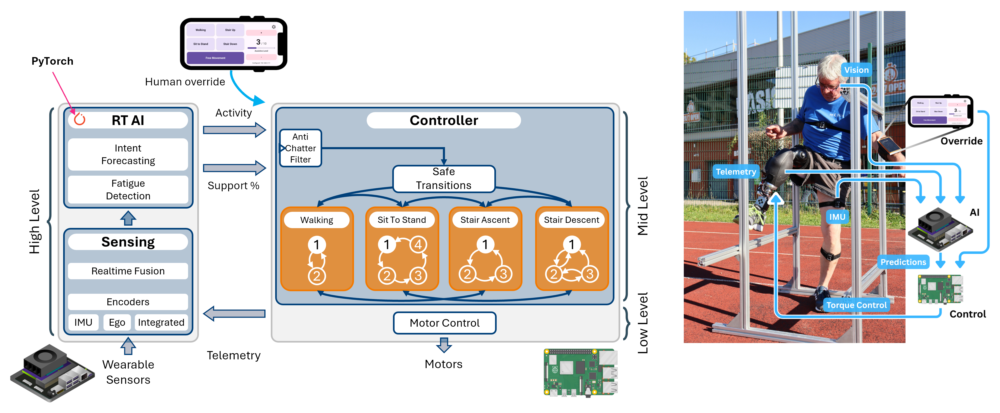
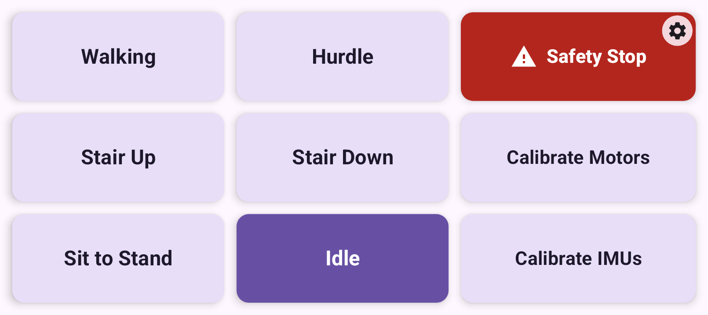
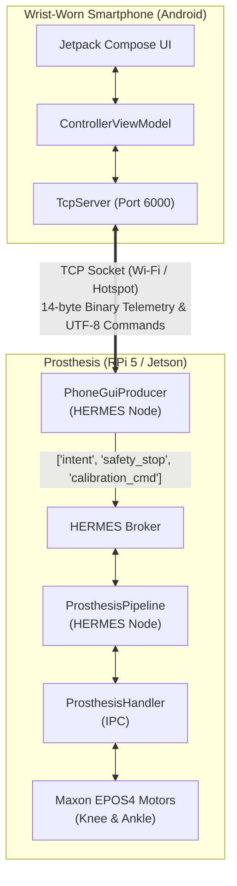

# AidWear Wrist-Worn Controller GUI

[](https://developer.android.com/)
[](https://kotlinlang.org/)
[](https://developer.android.com/jetpack/compose)
[](https://github.com/maximyudayev/hermes)
[](https://github.com/kuleuven-emedia/aidwear)

A lightweight Android UI application for wrist-worn smartphone **Human-in-the-Loop (HIL)** control over the [**AidWear**](https://github.com/kuleuven-emedia/aidwear) powered lower-limb bionic X-LEGs prosthesis.

The interface allows the wearer to manually select locomotion intents, execute emergency stops, trigger sensor and motor calibration routines, and *(future)* supervise and/or approve autonomous state changes proposed by high-level intent AI models.

---

## Visual Overview

<p align="center">
  
  <br>
  <em>Figure 1: Real-time AI-driven leg prosthesis pipeline with human-in-the-loop control. Sensor fusion stack (left), mid-level prosthesis control (middle), with wrist UI for manual control and AI decision approval.</em>
  
  <br>
  <em>Figure 2: Main supervisory 3×3 grid layout running in landscape mode on a wrist-mounted smartphone. Mode "Idle" is actively engaged.</em>
</p>

---

## Key Capabilities & User Experience

Designed specifically for mobility-assistive robotics with high safety margins and clear visual accessibility:

* 🦿 **Locomotion Intent Selection**: Six large, high-contrast touch tiles for rapid mode switching:
  * **Walking** (Continuous level-ground ambulation)
  * **Hurdle** (Obstacle clearance swing phase)
  * **Stair Up** (Stair ascent kinematic state machine)
  * **Stair Down** (Stair descent impedance profile)
  * **Sit to Stand** (Assisted sit-to-stand and stand-to-sit transitions)
  * **Idle** (Free movement / neutral non-powered joint compliance)
* 🛑 **Instant Safety Stop**: High-priority, oversized emergency halt button (`error` red palette) allowing the wearer to immediately disengage motor output and enter safe quickstop/idle state with haptic confirmation.
* ⚙️ **One-Touch Calibration Routines**:
  * **Calibrate Motors**: Triggers automated homing routine on the dual Maxon EPOS4 knee and ankle drives, to re-zero the absolute encoder angle for state machine control.
  * **Calibrate IMUs**: Re-zeros the N-pose orientations of the wearable BLE IMUs (Nicla Sense ME w/ custom firmware) over a 5.0 s period.
* 🤝 **_[Future]_ Bidirectional AI Negotiation**:
  * **Mode Change Approval**: When upstream AI intent models predict an upcoming locomotion mode transition, an attention-grabbing overlay appears with large green **ACCEPT** and red **REJECT** targets, accompanied by distinct haptic vibration pulses.
  * **Fatigue / Assistance Tuning**: Real-time prompt to increase or decrease prosthetic motor assistance levels based on biometric fatigue models.
* 🌐 **Wearable-Optimized UX & Localization**:
  * Immersive kiosk mode (hides system navigation and status bars with transient swipe reveal).
  * Dynamic vector typography that automatically scales to the display aspect ratio.
  * Multi-language support: **English**, **Dutch (Nederlands)**, and **French (Français)**.
* 🩺 **On-Device Diagnostics & Live Logs**:
  * Top-right settings menu displaying the device's assigned local IP address, listening port, and an auto-scrolling log view of incoming and outgoing socket packets.

---

## System Architecture & Integration

The GUI acts as a standalone TCP server communicating with the onboard embedded compute of the prosthesis (e.g., Raspberry Pi 5 or NVIDIA Jetson Orin NX) through the [aidwear.gui.PhoneGuiProducer](https://github.com/kuleuven-emedia/aidwear) node within the [HERMES middleware](https://github.com/maximyudayev/hermes) ecosystem.



---

## Communication Protocol & Wire Format

The application runs a lightweight, non-blocking TCP socket server on port `6000` (defined in `ServerConfig.SERVER_PORT`).

### 1. Connection Handshake
1. The HERMES client (`PhoneGuiProducer`) connects to the smartphone IP at port `6000`.
2. The phone displays a blocking overlay: *"Waiting for Handshake (GO)..."*.
3. Once the HERMES node initializes, it sends the ASCII string: `GO`
4. Upon receiving `GO`, the app completes the handshake (`isReady = true`), vibrates to confirm, and dismisses the waiting overlay.

### 2. App → HERMES Telemetry Packet (Binary)
All interactions from the wearer (intent selection, safety stop, calibration commands, fatigue confirmations) are packed into a fixed **14-byte binary frame (Big-Endian `>BBIQ`)**:

```
+------------+-------------+----------------------+--------------------------+
| Type (1B)  | Value (1B)  | Sequence ID (4B)     | System Timestamp (8B)    |
| uint8      | uint8       | uint32 (Big-Endian)  | uint64 (Big-Endian, ms)  |
+------------+-------------+----------------------+--------------------------+
 0            1             2                      6                        13
```

#### Field Specifications

| Offset | Field | Type | Description |
|---|---|---|---|
| `[0]` | **Command Type** | uint8 | `0`: `INTENT` (Locomotion mode)<br>`1`: `FATIGUE` (Assistance level)<br>`2`: `SAFETY_STOP` (Emergency toggle)<br>`3`: `CALIBRATE_MOTORS` (Motor homing)<br>`4`: `CALIBRATE_IMUS` (IMU zeroing) |
| `[1]` | **Command Value** | uint8 | **When Type = 0 (Intent Mode ID):**<br>&nbsp;&nbsp;`0`: `IDLE` (Stiff leg)<br>&nbsp;&nbsp;`1`: `WALKING`<br>&nbsp;&nbsp;`2`: `SIT_TO_STAND`<br>&nbsp;&nbsp;`3`: `STAIR_ASCENT` (Stair Up)<br>&nbsp;&nbsp;`4`: `STAIR_DESCENT` (Stair Down)<br>&nbsp;&nbsp;`5`: `HURDLE`<br>**When Type = 1 (Fatigue):** `0..10` assistance level |
| `[2..5]` | **Sequence ID** | uint32 | Monotonically incrementing packet counter for packet loss detection. |
| `[6..13]`| **Timestamp** | uint64 | Android monotonic system time in milliseconds (`System.currentTimeMillis()`). |

### 3. HERMES → App Commands (Plain UTF-8 Text)
The prosthesis companion AI sends request strings over the socket to trigger wearer confirmation dialogs:

* `REQUEST_MODE <ModeName>`: Triggers the mode switch verification overlay (e.g., `REQUEST_MODE Walking`).
* `REQUEST_FATIGUE <Level>`: Triggers the fatigue assistance adjustment dialog (e.g., `REQUEST_FATIGUE 4`).

---

## Screen & UI Layout Reference

The main view organizes tasks into an ergonomic 3×3 arrangement designed for rapid reachability:

| Grid Position | Element | Command Type / ID | Behavior |
|---|---|---|---|
| **Top-Left** | `Walking` | `INTENT` (`1`) | Engages continuous ground walking state machine. |
| **Top-Center** | `Hurdle` | `INTENT` (`5`) | Prepares high ground-clearance swing trajectory. |
| **Top-Right** | `⚠ Safety Stop` | `SAFETY_STOP` (`2`) | Cuts motor torque, toggles pause state, sets mode to `Idle`. |
| **Mid-Left** | `Stair Up` | `INTENT` (`3`) | Initiates stair climbing trajectory tracking. |
| **Mid-Center** | `Stair Down` | `INTENT` (`4`) | Initiates stair descent yielding resistance. |
| **Mid-Right** | `Calibrate Motors` | `CALIBRATE_MOTORS` (`3`) | Starts automatic motor zeroing and origin registration. |
| **Bottom-Left** | `Sit to Stand` | `INTENT` (`2`) | Activates sit/stand assistance kinematics. |
| **Bottom-Center**| `Idle` | `INTENT` (`0`) | Compliance mode (no powered joint torque). |
| **Bottom-Right** | `Calibrate IMUs` | `CALIBRATE_IMUS` (`4`) | Zeroes orientation reference for body-worn IMUs. |
| **Corner Floating** | `⚙` (Settings) | — | Opens Connection Info, Port, Diagnostics, and Language dialogs. |

---

## Setup & Deployment

### Prerequisites
* **Android Studio**: Ladybug (2024.2+) or newer.
* **Android SDK**: `compileSdk = 36`, `minSdk = 26` (Android 8.0 Oreo or higher).
* **JDK**: Version 11 or higher.
* **Target Hardware**: Any Android smartphone mounted to a wrist band / forearm sleeve or a dedicated Android smartwatch.

### Building from Source

Clone the repository and build using Gradle:

```bash
git clone https://github.com/kuleuven-emedia/aidwear-gui.git
cd aidwear-gui

# Build Debug APK
./gradlew assembleDebug

# Or install directly to connected phone via ADB
./gradlew installDebug
```

### Pairing with AidWear

1. Connect both the smartphone and the prosthesis controller (Raspberry Pi 5 / Jetson) to the same local Wi-Fi network (or host an access point / hotspot from the prosthesis).
2. Open the **AidWear Controller** app on the phone.
3. Tap the `⚙` (Settings) button in the upper-right corner and select **Connection Settings** to note the phone's IP address (e.g., `192.168.0.180`).
4. In your AidWear runtime YAML configuration (e.g., `run/prosthesis_gui/prosthesis.yml` or `run/test/gui.yml`), verify the producer settings match:
   ```yaml
   producer_specs:
     - package: "aidwear.gui"
       class: "PhoneGuiProducer"
       node_id: "gui_control"
       settings:
         phone_ip: "192.168.0.180"  # Match your phone's Wi-Fi IP
         phone_port: 6000           # Default listening port
         buf_len: 1000
   ```
5. Launch the AidWear controller stack:
   ```bash
   python -m hermes.aidwear.run --config run/prosthesis_gui/prosthesis.yml
   ```
6. The app will immediately receive `"GO"` and unlock the interface for live control.

---

## Project Structure

```
aidwear-gui/
├── app/
│   ├── src/main/
│   │   ├── java/com/emedia/aidwearcontroller/
│   │   │   ├── MainActivity.kt        # Compose UI, full-screen layout, dialogs, overlays
│   │   │   ├── ControllerViewModel.kt # State management, event dispatch, haptics
│   │   │   ├── TcpServer.kt           # Non-blocking coroutine TCP server & binary packer
│   │   │   ├── ServerConfig.kt        # Default server port configuration (6000)
│   │   │   ├── AppResources.kt        # String resources & localization (EN, NL, FR)
│   │   │   └── ui/theme/              # Material 3 typography, palette, and themes
│   │   ├── res/                       # App icons, drawables, XML configs
│   │   └── AndroidManifest.xml
│   └── build.gradle.kts
├── images/
│   └── gui.png                        # Wrist controller UI screenshot
└── README.md
```

---

## Related Projects & References

* **[AidWear Core Stack](https://github.com/kuleuven-emedia/aidwear)**: Hierarchical prosthesis controller, FSMs, EPOS4 motor drivers, and Nicla IMU pipelines.
* **[HERMES Framework](https://github.com/maximyudayev/hermes)**: Distributed multimodal sensing and real-time intervention systems.
* **[OpenAssist Framework](https://github.com/maximyudayev/openassist)**: Wearable AI-driven robotics stack.

---

## License & Attribution

Developed for the [**e-Media Research Lab, KU Leuven**](https://github.com/kuleuven-emedia).  
